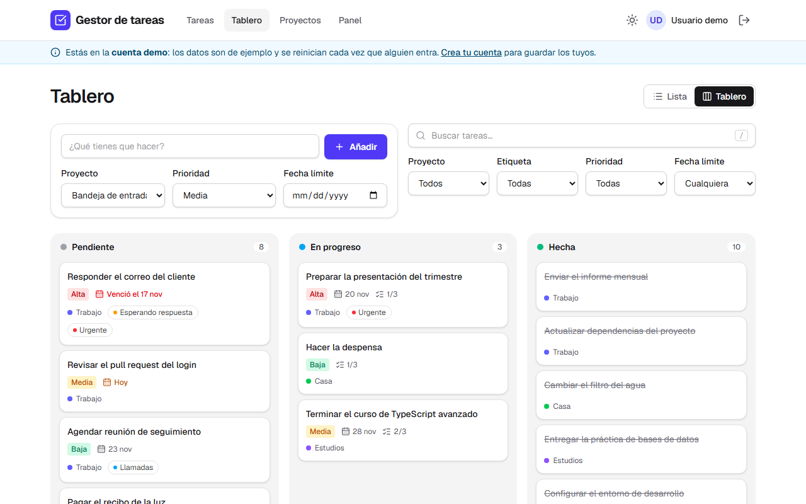
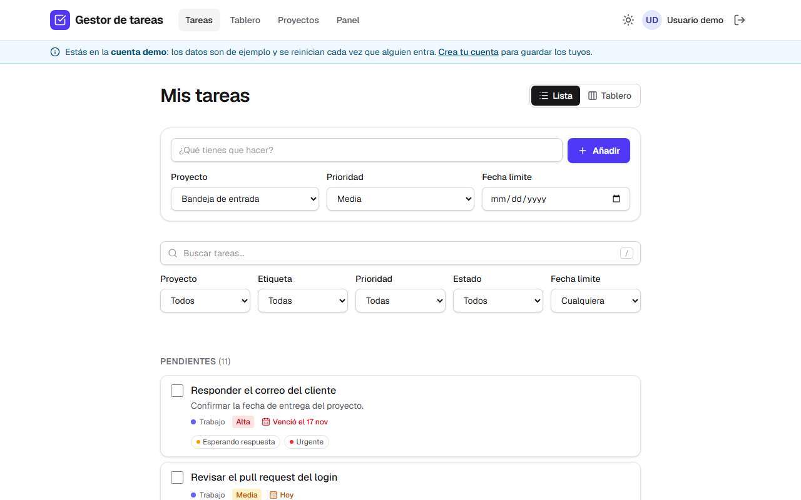
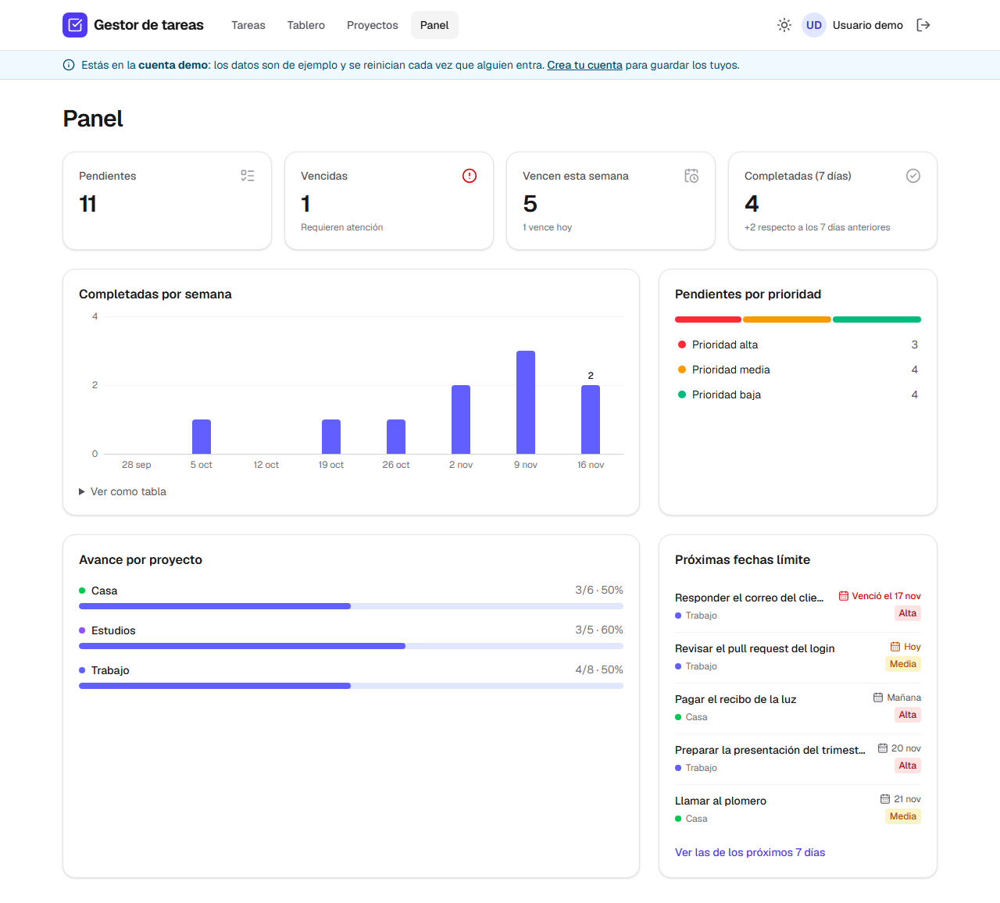
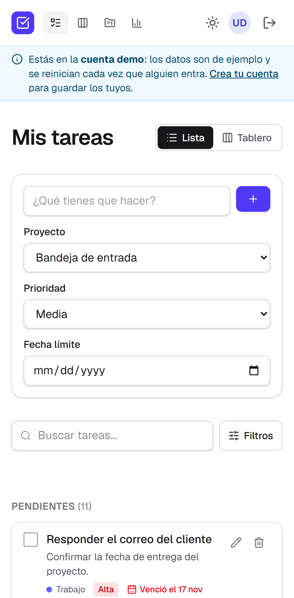

# Gestor de tareas

Gestor de tareas full-stack con **Next.js 16**, **Supabase** y **Tailwind CSS**: proyectos, etiquetas, subtareas, tablero kanban con arrastrar y soltar, filtros guardados en la URL y un panel de estadísticas.

[](https://github.com/jaimev54/gestor-tareas-next/actions/workflows/ci.yml)

**Demo:** [gestor-tareas-next-fnfa.vercel.app](https://gestor-tareas-next-fnfa.vercel.app) — pulsa **«Probar la demo»** para entrar sin registrarte (los datos de ejemplo se reinician en cada entrada).



## Funcionalidades

- **Cuentas de usuario:** registro con confirmación por correo, inicio de sesión, recuperación de contraseña y rutas protegidas.
- **Tareas:** alta rápida, descripción, prioridad, fecha límite, estado, subtareas y etiquetas. Las vencidas, las de hoy y las de mañana se distinguen al momento.
- **Proyectos y etiquetas** con colores; borrar un proyecto pide confirmación.
- **Tablero kanban** (Pendiente / En progreso / Hecha) con arrastrar y soltar usando el **ratón, el dedo o el teclado**. El orden se guarda.
- **Búsqueda y filtros** por proyecto, etiqueta, prioridad, estado y fecha. Se guardan en la URL: se pueden recargar y compartir.
- **Panel** con tareas pendientes, vencidas, completadas por semana, avance por proyecto y próximas fechas límite.
- **Modo claro, oscuro o del sistema**, sin parpadeo al cargar.
- **Diseño responsive** y **accesible**: navegación con teclado, foco visible, mensajes de error asociados a cada campo, anuncios para lectores de pantalla al mover tarjetas y tabla alternativa para el gráfico.

| Lista | Panel | Móvil |
|---|---|---|
|  |  |  |

## Tecnologías

| Área | Tecnología |
|---|---|
| Framework | [Next.js 16](https://nextjs.org/) (App Router, Server Components, Server Actions, Cache Components) y React 19 |
| Lenguaje | TypeScript |
| Estilos | [Tailwind CSS 4](https://tailwindcss.com/) e iconos de [Lucide](https://lucide.dev/) |
| Base de datos y autenticación | [Supabase](https://supabase.com/): PostgreSQL, Auth y Row Level Security |
| Validación | [Zod](https://zod.dev/) |
| Arrastrar y soltar | [dnd-kit](https://dndkit.com/) |
| Tests | [Vitest](https://vitest.dev/) (unitarios) y [Playwright](https://playwright.dev/) (e2e) |
| CI y hosting | GitHub Actions y [Vercel](https://vercel.com/) |

## Decisiones técnicas

- **Seguridad en la base de datos, no solo en la interfaz.** Cada tabla tiene *Row Level Security*: un usuario solo puede leer y modificar sus filas aunque llame a la API directamente. Las claves foráneas compuestas `(id, user_id)` impiden, por ejemplo, meter una tarea en el proyecto de otra persona.
- **Server Actions + Zod.** Todos los cambios pasan por funciones de servidor que validan los datos antes de tocar la base. Los formularios funcionan con `useActionState` y conservan lo escrito cuando hay un error.
- **Operaciones atómicas con funciones de Postgres.** Asignar etiquetas o mover una tarjeta en el kanban son varias escrituras; se hacen en una sola transacción con funciones SQL llamadas por RPC (`set_task_tags`, `move_task`).
- **Interfaz optimista.** Completar una tarea, mover una tarjeta o cambiar un filtro se ve al instante (`useOptimistic`) y se revierte si el servidor falla.
- **La URL como estado.** Los filtros viven en los parámetros de la URL y el servidor devuelve la lista ya filtrada.
- **Fechas y zona horaria.** Las fechas límite son tipo `date` y se manejan como texto `YYYY-MM-DD` para evitar desfases. El servidor (en UTC) conoce la zona horaria del usuario mediante una cookie, así «vencida» y «hoy» son correctos también de noche en México.
- **Cache Components (Next 16).** Las páginas se prerenderizan y solo lo que depende de la sesión se transmite dentro de `<Suspense>`.
- **Cabeceras de seguridad** (`X-Frame-Options`, `X-Content-Type-Options`, `Referrer-Policy`, `Permissions-Policy`) y protección contra *open redirect* en los enlaces de inicio de sesión.

## Tests

- **84 tests unitarios** (Vitest) de la lógica pura: fechas y zona horaria, filtros de la URL, estadísticas del panel, validaciones y redirecciones seguras.
- **26 tests e2e** (Playwright, en escritorio y móvil): página de inicio, tema, 404, cabeceras de seguridad, rutas protegidas y validación de formularios.
- **CI en GitHub Actions** en cada push y pull request: lint, comprobación de tipos, tests unitarios, build y tests e2e.

## Estructura

```
src/
  app/
    (auth)/         login, registro, recuperar y nueva contraseña
    (app)/          área privada: tareas, tablero, proyectos, panel
    auth/confirm/   destino de los enlaces de los correos
  components/       UI por funcionalidad (tasks, kanban, dashboard, tags, ui…)
  lib/              lógica: consultas, Server Actions, validación, fechas, filtros
  proxy.ts          renueva la sesión y protege las rutas
supabase/migrations/  esquema, RLS y funciones SQL
e2e/                  tests de Playwright
scripts/screenshots/  genera las capturas de este README
```

## Ejecutarlo en local

Requisitos: Node 24 y una cuenta de Supabase (el plan gratuito sirve).

1. Clona el repositorio e instala las dependencias:
   ```bash
   git clone https://github.com/jaimev54/gestor-tareas-next.git
   cd gestor-tareas-next
   npm install
   ```
2. Crea un proyecto en Supabase y ejecuta en el **SQL Editor**, en orden, los archivos de [`supabase/migrations/`](supabase/migrations).
3. Copia `.env.example` como `.env.local` y rellena la URL y la clave *publishable* de tu proyecto (Supabase → Project Settings → API Keys).
4. En Supabase → Authentication → URL Configuration, añade `http://localhost:3000/**` a las Redirect URLs.
5. Arranca la app:
   ```bash
   npm run dev
   ```

Opcional, cuenta demo: crea en Supabase → Authentication → Users el usuario `demo@example.com` (marcando *Auto Confirm User*) y pon su contraseña en `DEMO_PASSWORD` dentro de `.env.local`.

### Scripts

| Comando | Qué hace |
|---|---|
| `npm run dev` | Servidor de desarrollo en http://localhost:3000 |
| `npm run build` / `npm start` | Build de producción y servidor |
| `npm run lint` | ESLint |
| `npm run typecheck` | Comprobación de tipos |
| `npm test` | Tests unitarios |
| `npm run test:e2e` | Tests e2e (compila en `.next-e2e`, puerto 3100) |
| `npm run db:types` | Regenera los tipos de TypeScript desde la base de datos |
| `npm run screenshots` | Regenera las capturas del README |

## Limitaciones conocidas

- Sin dominio propio, el correo gratuito de Supabase solo llega a los miembros de la organización. Por eso existe la cuenta demo; para abrir el registro a cualquiera haría falta configurar un SMTP propio.
- La cuenta demo es compartida: si dos personas la usan a la vez, ven los cambios de la otra.
- No hay colaboración entre usuarios ni actualizaciones en tiempo real.

---

Proyecto de portafolio de **Jaime Vargas** · [GitHub](https://github.com/jaimev54)
